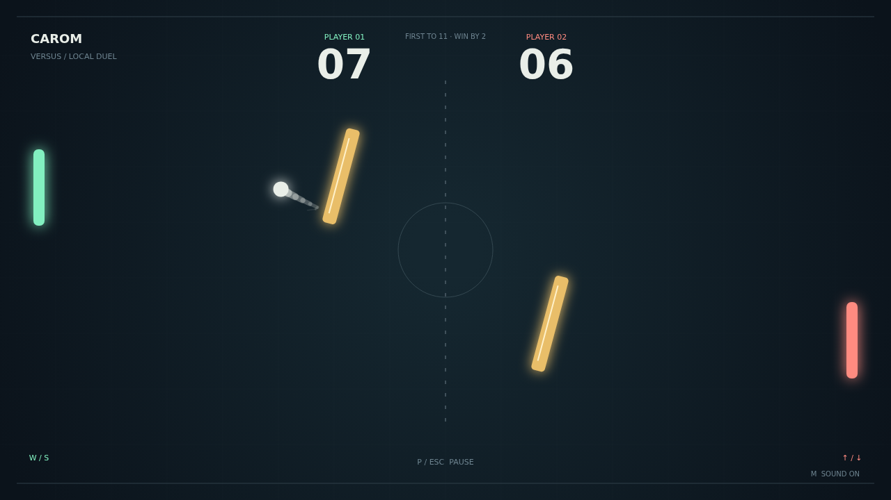

# Carom

Two paddles. Two moving obstacles. One opening to find. Carom turns a familiar paddle duel into a contest of timing and angles, on a dark court lit by mint, coral, and amber.

The first serve gives you a moment to get into position. Meet the ball squarely to send it across the court, or catch it near the end of your paddle to cut a steeper angle. Each return adds pace, and a quiet opening can become a frantic rally.

Move as you strike and the ball bends after it leaves your paddle. Spin rewards a well-timed swipe, while the swaying, rotating obstacles offer bank shots that change from moment to moment. Follow the curved trail, read the next angle, and turn a desperate save into an opening.

Challenge the house AI in Solo or share the court with a friend in Versus. Matches go to eleven with a two-point lead, so match point still asks for one more clean return.

